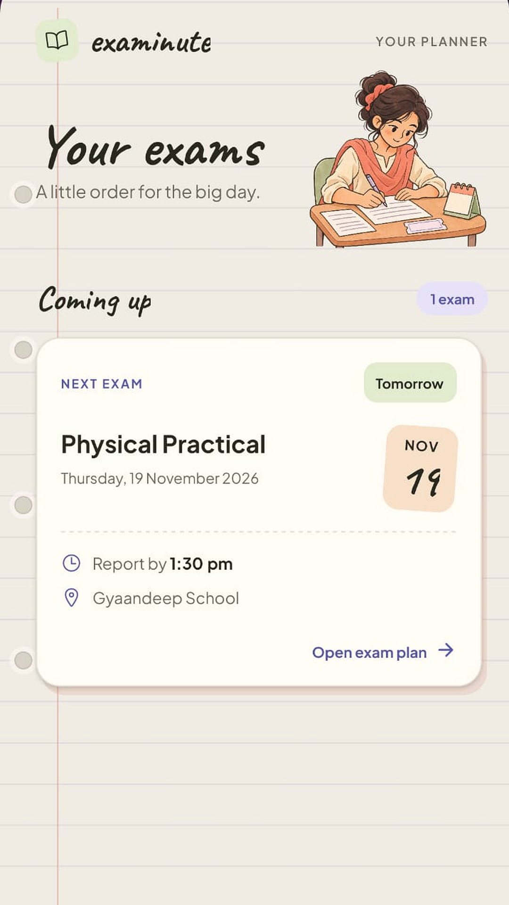
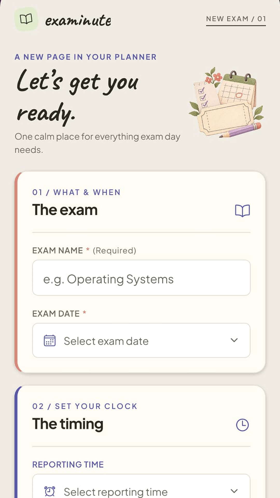
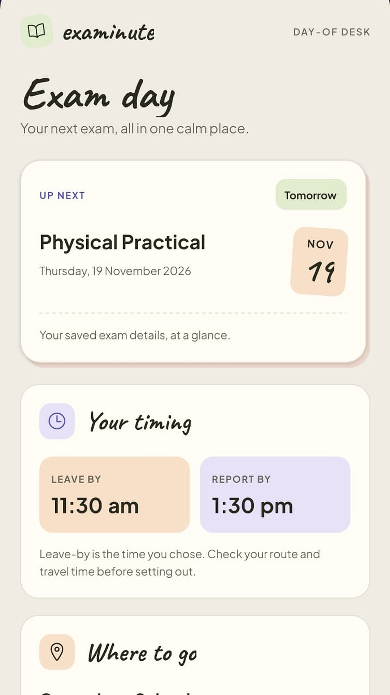
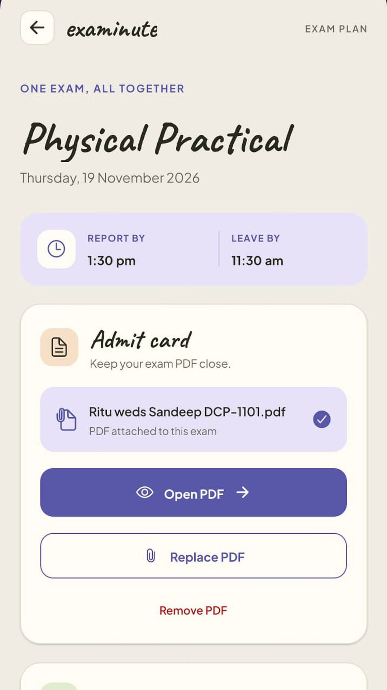

# Examinute


A notebook-style exam planner that keeps the important details close when exam day arrives.

## What it does

- Keep exam dates, reporting and leave-by times, centre details, and notes together.
- Attach an admit-card PDF to each exam and open it when needed.
- Get an optional reminder at 7:00 PM the evening before.
- See your next exam at a glance and open directions to its centre.
- Manage upcoming and earlier exams, with details stored on your device.

## Screenshots

<p align="center">
  
  
  
  
</p>

## Run locally

Requires Node.js and Yarn.

```bash
yarn install
npx expo start
```

Built with Expo, React Native, TypeScript, Expo Router, and SQLite.

## Feedback

Found a bug or have a suggestion? Email [SoloStack Dev](mailto:riteshsingh.py@gmail.com). See the [privacy policy](docs/privacy-policy.html) for how app data is handled.
