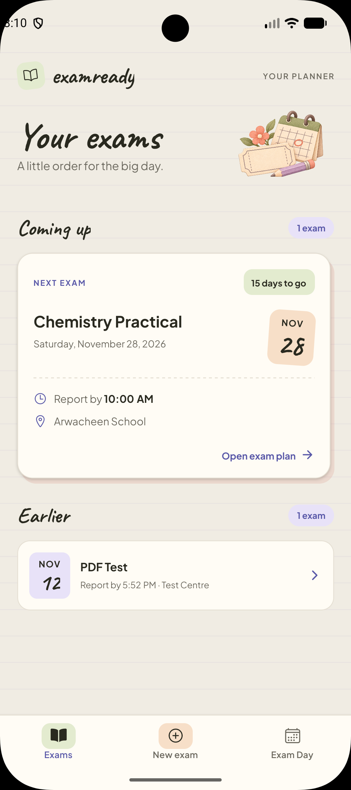
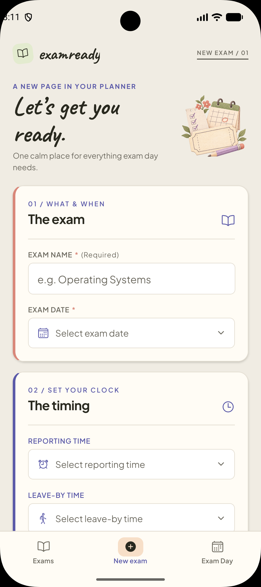
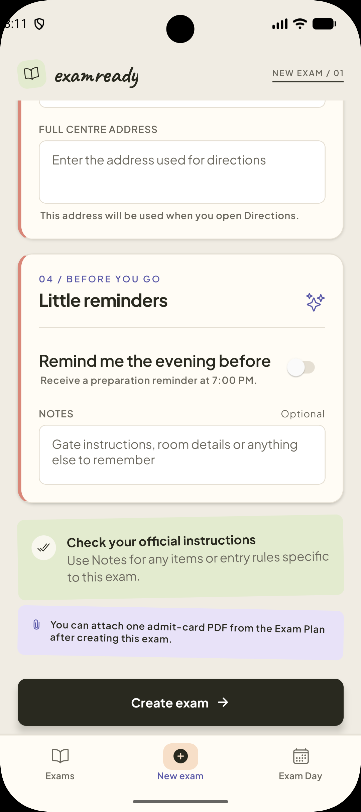
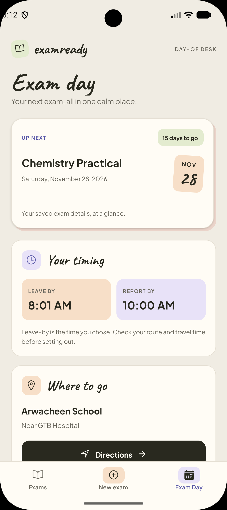
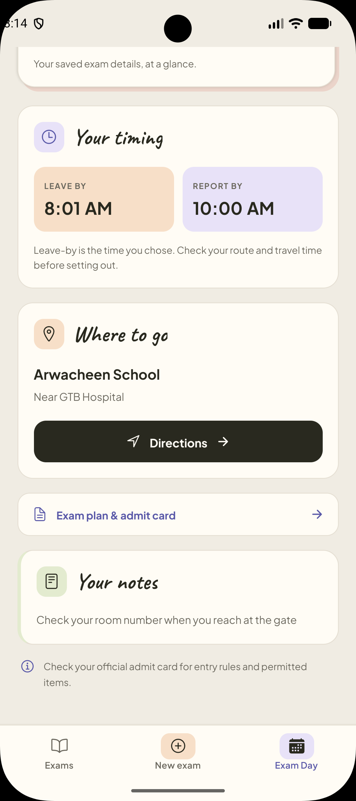
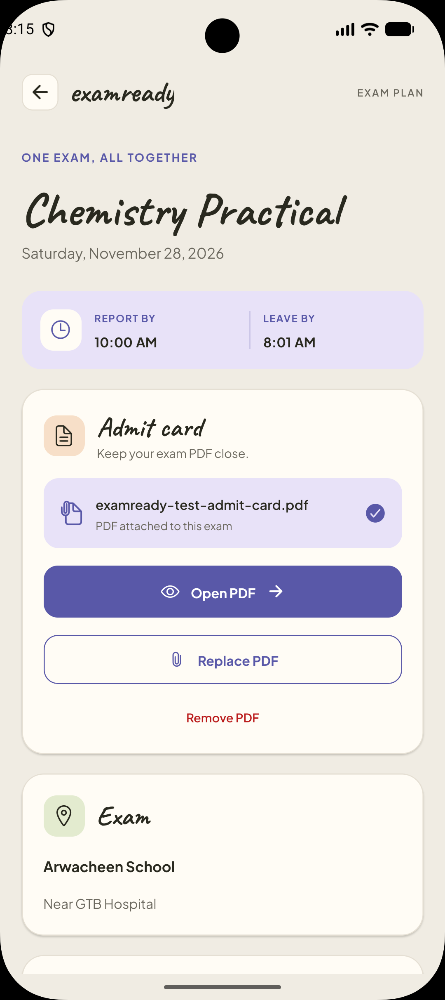

# Examinute

A notebook-style exam planner built with Expo and React Native. Keep exam dates, reporting and leave-by times, centre details, notes, and an admit-card PDF together.

## Screenshots

<table>
  <tr><th>Exams</th><th>Create exam</th></tr>
  <tr>
    <td></td>
    <td></td>
  </tr>
  <tr><th>Create exam details</th><th>Exam day</th></tr>
  <tr>
    <td></td>
    <td></td>
  </tr>
  <tr><th>Exam day details</th><th>Exam plan</th></tr>
  <tr>
    <td></td>
    <td></td>
  </tr>
</table>

## Run locally

```bash
yarn install
npx expo start
```

Open the project in Expo Go or an Android emulator.
